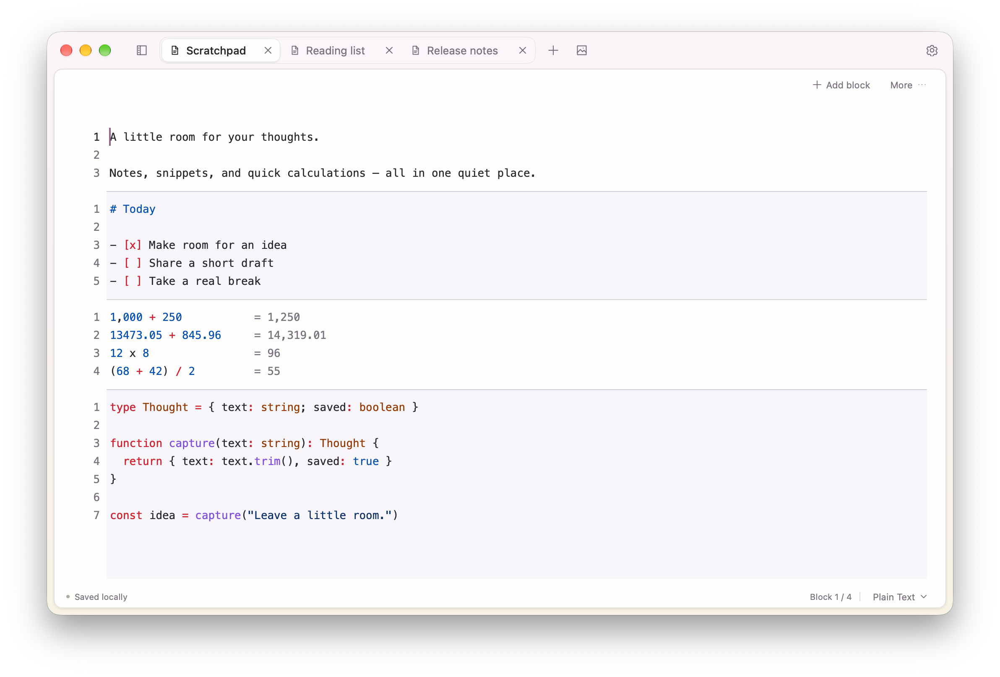

<p align="center">
  
</p>

<h1 align="center">Yohaku · 余白</h1>

<p align="center">给思绪留一点余白，也给 Mac 留一点内存。</p>

<p align="center"><a href="README.md">English</a> · 简体中文</p>

<p align="center">
  <a href="https://github.com/topit/yohaku/releases">下载预览版</a> ·
  <a href="LICENSE">MIT 许可</a> ·
  <a href="ROADMAP.md">产品规划</a>
</p>

Yohaku 是一款使用 **Go + [MyGo Native UI](https://github.com/egoist/mygo)** 构建的
轻量、本地优先桌面便笺工具。把文字、代码片段和临时计算放在一起，也可以新建图文笔记，
准备即将分享的带图内容。没有浏览器引擎、项目树或终端，只有标签页和安静的编辑区。

名字来自日语 **余白／よはく**，意为纸面上留出的空白。

> **早期版本，macOS 优先。** 已实际验证原生 Mac 工作流；尚未验证 Linux、Windows
> 桌面交互。下载包仅做本地临时签名，未做 Developer ID 签名或公证。升级前请备份重要笔记。



## 可以做什么

- **按块整理思绪。** 同一标签内混合文字、代码和 Math；细分割线、交错底色和可选的
  分块行号帮助阅读。整个笔记仍是连续编辑器，可以跨块选中、复制和搜索。
- **让代码片段清晰可读。** 提供 44 种模式，包括纯文本、Markdown、JSON、SQL、
  JavaScript、TypeScript、Go、Python 和 Math。切换块语言不改变正文。
- **边写边算。** Math 块逐行显示结果，支持变量、单位及计算器习惯的 `x`、`×`、`÷`。
  表达式尚未输入完整时保持安静，不急着报错。
- **把图片和文字放在一起。** 单独的图文笔记可粘贴截图、编写前后文及使用基础粗体；
  复制选区或整份内容时保留图文顺序。
- **回来接着写。** 自动保存并恢复未命名笔记、标签、选区、滚动位置和关闭归档。
  关闭标签不会删除内容。
- **少离开键盘。** `⌘K` 查找笔记与命令，`⌘,` 打开设置。主题、内置开源字体及
  中英文界面均可离线使用；应用和分块命令支持自定义快捷键，原生编辑键保持不变。
- **选择顺手的导航。** 横向标签和左侧边栏随时切换，不丢选区或撤销历史；窄窗自动回到横向。
- **运行可信的本地工具。** 离线 TypeScript 命令变换选区或当前块，可单步撤销。
  从设置 → 插件添加并明确启用，可先试内置示例。详见[插件指南](internal/localplugin/README.md)。
- **带上已有的 Heynote 笔记。** 导入原始笔记文件或整份笔记库，不修改源文件。

Yohaku 不是 IDE、完整的文档排版工具，也不完全复刻 Heynote。
没有分屏、文件树、终端、SSH 或 Git 面板。

## 在 macOS 上安装

从 [Releases](https://github.com/topit/yohaku/releases) 下载 ZIP：Apple Silicon 选
**arm64**，Intel 选 **amd64**。先用 `⌘Q` 退出旧版，解压后将 `Yohaku.app` 移入「应用程序」。

包仅做本地临时签名，**未经公证**，首次打开可能被 macOS 拦截。确认下载来源后，如系统提供
该入口，可在「系统设置 → 隐私与安全性」中选择「仍要打开」；不要全局关闭 Gatekeeper。
Release 附有 SHA-256 校验和；目前没有自动更新器。

红色按钮仅保存并收起窗口，点击 Dock 图标可恢复；`⌘Q` 或 Dock「退出」才彻底退出。
关闭标签是归档，不是删除。备份方式见[数据与恢复](#数据与恢复)。

## 从源码运行

在仓库根目录执行。需要 **Go 1.27.3**、Python 3 和 `patch`；初始化脚本会下载
MyGo v0.8.3 并应用仓库中的本地补丁。

```sh
sh scripts/bootstrap.sh
go run ./cmd/yohaku
```

在 macOS 上构建并打开当前架构的应用包：

```sh
sh scripts/build-macos.sh
open build/Yohaku.app
```

打包后运行不需要 Go、Python、Node.js 或浏览器。脚本不会安装、签名、公证或上传应用，
目前也没有自动更新器。

在 macOS 上，点击红色窗口按钮会先保存再收起窗口，应用仍驻留内存；点击 Dock 图标可恢复
原窗口，保留撤销历史和阅读位置。使用 `⌘Q` 或 Dock 菜单里的「退出」才会保存并彻底退出。
保存失败时不会收起窗口，也不会退出应用。

测试时可以使用独立数据目录：

```sh
go run ./cmd/yohaku -data-dir /tmp/yohaku-scratch
```

请先退出正在运行的 Yohaku：应用采用单实例机制。不要让开发版和打包版同时编辑同一数据目录。

## 常用快捷键

| 操作 | macOS 快捷键 |
| --- | --- |
| 新建分块笔记／新建图文笔记 | `⌘N` / `⌘⌥N` |
| 关闭／重开最近关闭的标签 | `⌘W` / `⌘⇧T` |
| 重命名标签 | `⌘⇧R` 或双击标签 |
| 添加块／在光标处拆块 | `⌘Enter` / `⌘⇧Enter` |
| 在当前块前插入空白块 | `⌥Enter` |
| 选择当前块语言 | `⌘L` |
| 选中当前块／整份分块笔记 | `⌘A` / `⌘⇧A` |
| 在分块笔记中搜索替换 | `⌘F`，再展开替换控件 |
| 撤销／重做 | `⌘Z` / `⌘⇧Z` |
| 复制当前 Math 行的结果 | `⌘⇧C` |
| 导入 Heynote 文件 | `⌘⇧I` |
| 命令中心／设置 | `⌘K` / `⌘,` |
| 立即保存 | `⌘S` |

设置中的快捷键页支持查找、录入、停用及恢复应用和分块命令，拒绝冲突和保留键；保存后生效。
原生编辑键和插件命令的快捷键暂不支持修改。
图文笔记的全选仍是普通的整份文档全选，不涉及分块。
单光标位于完全为空的块内时，退格会删除该块并进入前一块末尾；首块保留。
空格与空行仍算内容，不会直接删块。插入和删除均可撤销。
右键分块可复制正文、上移／下移、拆分、切换语言或确认删除。
菜单打开后正文若已变化，会拒绝过期操作，避免误改其他块；重新打开菜单即可。

## 不离开笔记，直接计算

将块语言切换为 **Math**，每行输入一个表达式：

```text
12 x 3               # 36，也支持 12x3、12×3
2 + 3 x 4            # 14
price = 19
quantity = 3
price x quantity     # 57
prev + 5             # 62
13 inches in cm      # 33.02 cm
sqrt(81)             # 9
sin(90 deg)          # 1
```

可以在公式前写说明文字，用空格隔开，如 `卫生纸 111 + 222`。支持完整的千分位分组，
如 `1,234.50 + 2,000`；函数调用内逗号仍用于分隔参数，`max(1,234)` 的结果是 `234`，
不是 `1234`。

右键 Math 行的行号区域，选择**设为行变量 x1**，会插入可见、可撤销的赋值前缀。
后续行即可引用它：

```text
x1 = 1 月消费 1000 + 2000
x2 = 2 月消费 1000 + 3000
合计 x1 + x2 =
```

在末尾输入 `=` 后，按 **Tab** 插入 `7000`；Escape 关闭候选。变量前缀随正文保存，
删除其他行不会重新编号。每个块拥有独立变量作用域，自上而下计算；`prev` 表示此前
最近一次成功的结果。

行尾结果在接受补全前仅用于显示，不进入保存正文、选区或撤销历史。点击结果、
使用复制结果按钮或 `⌘⇧C`，均复制与显示一致的数值。

计算使用随应用内置、运行于 MoeJS 的 math.js，不需要联网或 Node.js。这是有限制的标量
计算器，不是完整 math.js：不支持矩阵、用户脚本、实时汇率或完整 Spotlight 自然语言。
基础标量运算使用十进制计算，其他运算保留 math.js 的数值行为；结果最多显示 14 位
有效数字，不保证任意精度或财务精度。错误和超限会显示；`4/`、`sqrt(` 等未完成输入暂不报错。

## 图文与分享

点击图片按钮或按 `⌘⌥N` 新建**图文笔记**，粘贴图片或含内嵌图片的 HTML。
文字与图片共享选区和撤销历史。它与分块／Math 笔记是两种独立类型，暂不提供分块笔记的
搜索栏或语法高亮。

复制提供自包含 HTML、RTF、纯文字和 Yohaku 自有格式；macOS 另提供带图片附件的原生
RTFD。**已实际验证粘贴到 TextEdit。** 尚未验证微信、钉钉及具体 AI 客户端：接收应用
决定使用哪种剪贴板格式，只接收纯文字的输入框会丢弃图片。

图片内嵌保存于会话中，归档和恢复副本也包含图片，不依赖临时文件或外部 URL。
外链／文件图片引用会被拒绝。每张图编码上限为 8 MiB、最多 1200 万像素；粘贴输入数据和
候选笔记序列化内容各按 32 MiB 检查。这是粘贴检查，不是总内存硬限制，大文档仍可能导致
界面短暂停顿。

## 从 Heynote 导入

macOS 启动时会发现 `~/Library/Application Support/Heynote/notes/`，**先询问授权，
再读取笔记正文**。点击「授权并导入」后自动复制为新标签；选择不导入则不读取。
导入或拒绝后不再随启动重复提示；可从**设置 → 数据**、文件菜单或命令中心重新发起。
这是应用内的读取确认，不是替用户授予 macOS 文件系统权限；系统拒绝访问时会显示错误，
不擅自更改源目录权限。完成标记与笔记一起原子保存，保存失败仍保留内存内容并阻止正常退出。

使用 **文件 → 导入 Heynote 文件…** 选择 `.txt` 文件，也支持旧版 `buffer.txt`；
或使用**导入 Heynote 笔记库…** 选择笔记目录。需要保留 `∞∞∞` 分块标记的原始文件，
不是纯文本导出。新版默认库位于 Heynote 用户数据目录下的 `notes`；自定义库使用
Heynote 设置中的路径。

- 每个文件成为一个新标签，保留名称、块顺序、正文和已支持的语言。
  未知语言降为纯文本并提示。
- 所选文件全部解析成功后才一起添加，任一失败则整批不导入。
  不覆盖已有笔记或源文件。
- 导入是复制，不是同步；重复导入会产生更多副本。
- 附件仅保留文字引用，不迁移图片；不迁移设置、元数据或光标位置。
  超出 Yohaku 计算范围的 Math 可能报错，但会保留原文。

建议先备份笔记库，从小批量开始；尚未验证超大规模导入的响应时间。

侧边栏、本地插件、自定义快捷键和块菜单的完成范围与后续边界，见 [产品规划](ROADMAP.md)。

## 数据保存与恢复

| 平台 | 默认会话文件 |
| --- | --- |
| macOS | `~/Library/Application Support/Yohaku/session.json` |
| Linux | `$XDG_DATA_HOME/yohaku/session.json`，否则 `~/.local/share/yohaku/session.json` |
| Windows | 用户配置目录下的 `Yohaku/session.json` |

`session.json` 现在是 v3 索引，仅保存标题、文件引用、标签顺序、归档和阅读位置。
**所有分块笔记正文都在 `notes/` 中，每篇一个 `.txt`**，保留语言边界标记。
图文笔记在同目录保存为 `.rich.json`，图片独立放在 `images/`，按 SHA-256 去重。
文件名由稳定笔记 ID 派生，不随标题变化；`session.json` 中可查标题与文件名对应关系，
未命名和重名笔记也不会覆盖。偏好仍在 `preferences.json`。
设置 → 数据可直接打开笔记目录或完整数据目录。这些文件可查看和备份，暂不支持外部编辑同步。

- 正文或标签变更后约 750ms 自动保存，使用同目录临时文件、文件同步和原子重命名。
  仅写变化的笔记和新增图片；跨文件保存先将数据同步到暂存区，再发布
  `.pending-save.json` 待完成事务，启动／重试时先补完，最后安装新索引。
  只有标签／标题／位置变更时，仅原子替换索引。正常退出前强制保存；恢复失败时请保留待完成事务文件。
- 单独滚动、移动光标不触发保存。阅读位置随下次编辑／标签变更、手动保存或正常退出写入。
- **关闭是归档，不是删除。** `⌘⇧T` 或命令中心可重开；归档跨重启保留，
  不自动清理，因此仍占用存储空间。
- 同次运行中，切换、关闭及重开标签保留撤销历史；**重启不恢复撤销栈**。
- 保存失败持续可见，保留内存内容、重试并阻止正常退出。
  强制退出前应先导出恢复副本；仅在内存中的内容并未持久保存。
- 库损坏、版本不支持、正文／图片缺失或待完成事务损坏时停止恢复，不静默新建空白笔记。
  **备份需要复制整个数据目录，不能只备份 session.json**。当前不自动清理图片，
  避免破坏归档和撤销引用；恢复副本导出仍自包含正文、图片和归档。使用恢复副本时，先退出应用，
  将副本放入另一目录并命名为 `session.json`，再通过 `-data-dir` 指向该目录。
  恢复导出不包含偏好设置。

旧 v1/v2 会话和导出的恢复副本仍可打开，首次保存前将原字节备份为
`session.legacy-backup.json`，再迁移到独立文件。该备份不会随日常保存更新，
仅代表迁移前状态。旧版应用无法打开 v3；降级应将自包含恢复副本放入独立目录，
不要让新旧应用操作同一库。待完成事务保护已发布的保存；崩溃前还没进入保存的输入仍可能丢失。

## 轻量，也说明代价

原生 UI 不需要浏览器运行时，但不代表所有工作负载都没有成本。
Math 按需初始化 MoeJS JavaScript VM：30 秒没有计算后释放，或在任务之间按最多
500 次尝试／累计 36,000 行正文限制寿命；较大快照会在跨越行预算前重建。
释放不会清空显示结果，变量按笔记正文重建。VM 可被 GC 回收不等于立即把页面归还
操作系统；编译后的 math.js 缓存、图片和归档仍会消耗内存与存储。

### 独立笔记存储与旧全量保存的对比

2026 年 11 月 10 日，同一台 macOS 27.2 arm64 Mac satellite（M4 Pro，Go 1.27.3），
使用相同合成数据，比较存储改动前后：

| 样例 | 单篇修改保存，旧 → 新 | 每次累计分配，旧 → 新 | 整应用 footprint，旧 → 新 |
| --- | ---: | ---: | ---: |
| 10 篇文本，约 0.95 MiB | 2.40 → 4.37 ms | 4.09 → 0.42 MiB | 77.5 → 72.8 MiB |
| 100 篇文本，约 9.5 MiB | 16.52 → 4.77 ms | 42.51 → 0.66 MiB | 145.3 → 98.7 MiB |
| 8 篇图文，共用同一张高熵 1200×800 PNG，修改普通文字标签 | 48.60 → 3.98 ms | 200.90 → 0.05 MiB | 281.7 → 158.8 MiB |

保存／分配为三轮、每轮 10 次 Go 基准操作的中位数；累计分配**不是内存峰值或常驻量**。
整应用为三次独立原生启动，每次静置六秒、采样三次 vmmap；新版在测量前完成迁移。
应用没有强制 GC。跨文件恢复增加同步开销：小笔记保存可能更慢，100 个文件的首次写入
为 162ms，旧单文件为 16ms。重图片样例的恢复累计分配也从约 199 增至 250 MiB，
不能因静置 footprint 更低就忽略。图片／归档仍全部恢复到内存，不是惰性加载、长期泄漏测试、
Heynote 对照或用户本机实测。`scripts/perf-macos.py` 生成固定数据；
设置 `YOHAKU_PERF_FIXTURES` 后运行 `BenchmarkLibraryStorage` 可复跑新旧两条存储路径。

### 与 Heynote 的真实使用对比

以下已安装版本的对比早于 MoeJS 迁移，不是当前源码版本的测量结果。

2026 年 11 月 10 日，在同一台 **M1 Pro MacBook Pro、32 GiB 内存、macOS 27.2** 上，
手动退出并重新打开两个应用。双方各打开一份 **353 块**的笔记，包含 40 个 Math 块、
44 个 Markdown 块，规范化正文约 157 KiB。去除仅用于序列化的边界换行后，353 块正文
逐块一致；私人笔记不作为基准样例分发。

| 应用 | Physical footprint 中位数 | 七次采样范围 |
| --- | ---: | ---: |
| Heynote 2.9.1，主进程 + Renderer + GPU + Network Utility | 167.6 MiB | 167.5–184.7 MiB |
| Yohaku 0.1.0（build 1），单进程 | **128.9 MiB** | 128.9–129.0 MiB |

**本次工作负载下少约 39 MiB，约省 23% 内存。**启动约一分钟后开始，逐个应用进程运行
`vmmap -summary`，交替两应用采样顺序，共七轮。两应用启动时间只差四秒，期间各进程
`top CMPRS` 压缩读数均为零。

这是一次重启后的观察，**不是七次独立启动，也不是综合速度对比**。一个 JSX／纯文本语言
标记及额外关闭／未打开笔记有所不同；未核实尚未保存的内存正文、Math 预热和缓存历史。
仅计入已识别的应用包进程，没有将独立宿主的操作系统服务分摊到任一应用。
因此不含后来识别的 Heynote macOS 自动填充服务，也不能把它后测的内存加到七轮中位数上。
系统内存压力正常，但其他工作负载仍使用了大量压缩内存。进程 footprint 合计不是系统级
去重 RAM；已安装 Yohaku 的精确源代码版本也未核实。这些结果表明此处测得的内存更低，
不代表所有场景下启动、输入或计算都更快。

后续另做的**单次快照**还计入系统责任归属指向各应用的 macOS 服务，结果为
**Heynote 184.8 MiB／Yohaku 125.8 MiB**。两边均计入各自的 SetStoreUpdateService，
Heynote 另计 AutoFill。这些服务不是普通子进程。本次缓存／压缩状态已不同，
不能用来修正上面的七轮中位数，也不代表固定节省比例。

### 图片恢复

macOS 27.2 arm64 上，固定八图样例（每份使用同一张合成的 1200×800 PNG，四份打开、
四份归档，普通文字标签活动）的原生 physical footprint 在图片优化后为
**100.3 → 70.9 MiB**；恢复基准为 **122.6 → 18.9ms**，前后开启相同的 profiling。
两者均为三轮中位数，不代表任意图库的固定表现。

图片导入／恢复时仍完整校验，首次显示后才保留解码位图；已查看过的图片继续缓存。
首张图的软件渲染基准从约 5ms 增至 9ms，这不是原生输入延迟测量。

在有桌面会话及 System Events 辅助功能权限的 Mac 上，可重现固定样例和原生测量。
先退出正在运行的应用，按顺序执行测量，不要并行运行：

```sh
python3 scripts/perf-macos.py fixtures /tmp/yohaku-perf
python3 scripts/perf-macos.py measure /tmp/yohaku-perf \
  --app build/Yohaku.app --kind yohaku --output /tmp/yohaku-memory.json
```

脚本使用隔离数据，不读取个人笔记库。各进程 footprint 之和不等于系统级去重物理内存。
这些测量不承诺长期无泄漏或所有场景的固定内存占用。

## 开发

完成初始化后：

```sh
go test ./...
go test -race -count=1 ./...
go vet -tags mygo_noinspector ./...
go -C .deps/mygo test ./ui/editor ./ui/richtext
```

Linux 软件 UI 测试需要 GTK 3、Fontconfig、DejaVu 和 Noto CJK 字体；Ubuntu 包名见
[CI 工作流](.github/workflows/build.yml)。原生 macOS UI 和输入法检查仍需 Mac，
软件 UI 测试不能替代原生验证。CI 在 Linux 和两种 macOS 架构上运行 race 测试及生产配置 vet，
构建本地临时签名的 ZIP；仅在全部任务通过、`v*` 标签与 [`VERSION`](VERSION) 一致时发布预览版。

### 本地 MyGo 补丁

`go.mod` 显式替换到可重建的 `.deps/mygo`。初始化脚本重放 [`patches/`](patches) 中的
六份补丁：事务拒绝与 IME 一致性、块分割线／行号、图文剪贴板／滚动支持、Math
行尾结果前的光标位置、按实际字形命中，以及结果对齐的纯显示间距（行宽不足时保留自然换行）。
不修改共享 module cache；升级框架时需审阅并重新验证补丁。

一份分块笔记使用一个 Buffer，而不是每块一个编辑器。普通编辑若破坏边界，会**整批拒绝**，
包括多光标和全部替换。跨块选中、复制仍可使用，整份复制会包含底层分块标记；
结构修改请使用加块、拆块、删块和换语言命令。逐块高亮不等同于逐块语言感知的缩进、
注释或括号补全。

应用测试覆盖恢复、保存失败、归档、边界保护、撤销、Math 和图像绘制。
原生 Mac 检查包含图文传输到 TextEdit 及中文拼音输入，但未覆盖全部输入法序列、
接收应用或操作系统。更广的上游 MyGo UI 测试中，三个 Linux 文字绘制像素检查在未打补丁的
v0.8.3 上也失败；不将这些检查算作通过。

## 致谢与第三方许可

Yohaku 自有代码采用 [MIT 许可](LICENSE)。第三方组件仍遵循各自许可证，
不代表将 Heynote 或随附素材重新授权为 MIT。

**基础组件：** [MyGo](https://github.com/egoist/mygo) 提供原生 UI 与编辑器；
[math.js](https://mathjs.org/) 与 [MoeJS](https://github.com/MoeForge/moejs) 提供离线计算；
JetBrains Mono、IBM Plex Mono、Source Code Pro 为随应用内置的 OFL 字体。

**代码与设计参考：**

- [mojian](https://github.com/ox0pine/mojian)：在 MIT 许可下借鉴／改编编辑器接线与标签栏代码、设计，保留版权声明。
- [Kero](https://github.com/egoist/kero)：命令中心、主题及字体选择交互参考。
- [Magpie](https://github.com/yetone/magpie)：横向导航与侧栏切换参考。
- [Heynote](https://github.com/heyman/heynote)：分块便笺灵感与文件协议参考；
  未打包其实现或运行时。其许可包含 Commons Clause，不将其视为无限制 MIT 依赖。

致谢说明依赖与参考关系，不表示上述项目为 Yohaku 背书。

完整许可与署名见 [THIRD_PARTY_NOTICES.md](THIRD_PARTY_NOTICES.md)，
包括改编的 MIT 代码声明；macOS 构建会将依赖许可打入应用包。
