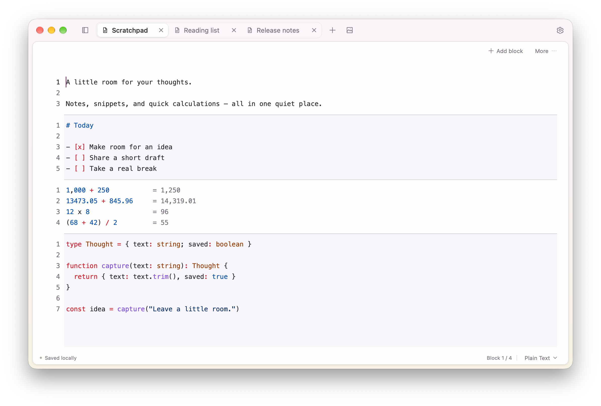

<p align="center">
  
</p>

<h1 align="center">Yohaku · 余白</h1>

<p align="center">A little room for your thoughts. A lighter footprint on your Mac.</p>

<p align="center">English · <a href="READE.zh.md">简体中文</a></p>

<p align="center">
  <a href="https://github.com/topit/yohaku/releases">Download preview</a> ·
  <a href="LICENSE">MIT license</a> ·
  <a href="ROADMAP.md">Roadmap</a>
</p>

Yohaku is a lightweight, local-first desktop scratchpad built with **Go and
[MyGo Native UI](https://github.com/egoist/mygo)**. Keep text, code snippets and
quick calculations in one place, or open an image & text note to prepare something
to share. No browser engine, project tree or terminal—just tabs and a quiet editor.

The name comes from the Japanese **余白 / よはく**: the space left on a page.

> **Early-stage, macOS-first.** Native macOS workflows have been tested; Linux and
> Windows desktop behavior has not. Release downloads are ad-hoc signed, not
> Developer ID signed or notarized. Back up important notes before upgrading.



## What you can do

- **Think in blocks.** Mix prose, code and Math within a single tab. Thin dividers,
  alternating backgrounds and optional per-block line numbers keep things legible.
  Select, copy and search across blocks in one continuous editor.
- **Keep snippets readable.** Choose from 44 modes, including plain text, Markdown,
  JSON, SQL, JavaScript, TypeScript, Go, Python and Math. Change a block's language
  without changing its content.
- **Calculate where you write.** Math blocks show results beside each line, with
  variables, units and calculator-style `x`, `×` and `÷` operators. Incomplete
  expressions stay quiet while you type.
- **Hold images and text together.** A separate image & text note supports pasted
  screenshots, surrounding text and basic bold formatting. Copy a selection or the
  whole document with its image order preserved.
- **Pick up where you left off.** Autosave restores unnamed notes, tabs, selections,
  scroll positions and closed-note archives. Closing a tab does not delete it.
- **Stay on the keyboard.** Use `⌘K` to find notes and commands; open settings with
  `⌘,`. Customize application/block shortcuts; native editing keys stay unchanged.
  Themes, bundled open-source fonts and Chinese/English UI work offline.
- **Choose your navigation.** Toggle between horizontal tabs and a left sidebar
  without losing your selection or undo history. Narrow windows fall back to tabs.
- **Run trusted local tools.** Offline TypeScript commands transform a selection
  or block, with one-step undo. Add and explicitly enable them in Settings → Plugins;
  start with the bundled example. See [the plugin guide](internal/localplugin/README.md).
- **Bring your Heynote notes.** Import original note files or an entire library
  without modifying the source.

Yohaku is not an IDE, a full document-layout editor or a complete Heynote clone.
There are no split panes, file trees, terminals, SSH sessions or Git panels.

## Install on macOS

Download a ZIP from [Releases](https://github.com/topit/yohaku/releases):
choose **arm64** for Apple Silicon or **amd64** for Intel. Quit an older Yohaku
with `⌘Q`, unzip the archive and move `Yohaku.app` into Applications.

Builds are ad-hoc signed but **not notarized**. macOS may block the first launch;
after verifying the download's origin, use **System Settings → Privacy & Security
→ Open Anyway** if offered. Do not disable Gatekeeper globally. Release assets
include SHA-256 checksums; there is no automatic updater.

The red window button saves and hides the editor; click its Dock icon to return.
Use `⌘Q` or Dock → **Quit** to exit completely. Closing a tab archives that note;
it does not delete it. [Data and recovery](#your-data-and-recovery) explains backups.

## Run from source

Run these commands from the repository root. Use **Go 1.27.3**, Python 3 and `patch`;
bootstrap downloads MyGo v0.8.3 and applies the repository's local patches.

```sh
sh scripts/bootstrap.sh
go run ./cmd/yohaku
```

On macOS, build and open an app bundle for your current architecture:

```sh
sh scripts/build-macos.sh
open build/Yohaku.app
```

The bundle does not require Go, Python, Node.js or a browser at runtime. The script
does not install, sign, notarize or upload it. There is no automatic updater.

On macOS, the red window button saves and hides the window without quitting.
Click the Dock icon to restore it, including its undo history and reading position.
Use `⌘Q` or **Quit** in the Dock menu to save and exit completely. A failed save
keeps the window open instead of hiding it, and prevents quitting.

For experiments, use a separate data directory:

```sh
go run ./cmd/yohaku -data-dir /tmp/yohaku-scratch
```

Quit any running Yohaku instance first: the application is single-instance. Do not
run development and packaged copies against the same data directory concurrently.

## Keyboard essentials

| Action | macOS shortcut |
| --- | --- |
| New block note / new image & text note | `⌘N` / `⌘⌥N` |
| Close / reopen last closed tab | `⌘W` / `⌘⇧T` |
| Rename tab | `⌘⇧R` or double-click the tab |
| Add block / split at cursor | `⌘Enter` / `⌘⇧Enter` |
| Insert an empty block before the current block | `⌥Enter` |
| Choose current block language | `⌘L` |
| Select current block / entire block note | `⌘A` / `⌘⇧A` |
| Find and replace in a block note | `⌘F`, then expand replacement controls |
| Undo / redo | `⌘Z` / `⌘⇧Z` |
| Copy current Math line's result | `⌘⇧C` |
| Import Heynote files | `⌘⇧I` |
| Command center / settings | `⌘K` / `⌘,` |
| Save now | `⌘S` |

The settings shortcut page lets you search, record, disable and reset application
and block commands. Conflicting or reserved keys are rejected; save to apply.
Native editing shortcuts and plugin command bindings are not configurable yet.
Image & text notes use normal whole-document Select All; they do not have blocks.
With a single caret in a completely empty block, Backspace removes that block
and moves to the previous block's end. The first block is kept; spaces and
blank lines count as content. Insertion and removal can be undone.
Right-click a block to copy its body, move it up/down, split, change language or
delete with confirmation. A menu opened before a document edit cannot affect a
different block accidentally; reopen it when the target has changed.

## Math, without leaving your note

Change a block's language to **Math**, then write one expression per line:

```text
12 x 3               # 36 (12x3 and 12×3 work too)
2 + 3 x 4            # 14
price = 19
quantity = 3
price x quantity     # 57
prev + 5             # 62
13 inches in cm      # 33.02 cm
sqrt(81)             # 9
sin(90 deg)          # 1
```

Descriptions can precede formulas, separated by whitespace. Thousands separators
work in complete groups, such as `1,234.50 + 2,000`. Inside function calls commas
remain argument separators: `max(1,234)` returns `234`, not `1234`.

Right-click a Math line's gutter and choose **Set line as variable x1** to insert
a visible, undoable assignment prefix. Subsequent lines can reference it:

```text
x1 = 1 月消费 1000 + 2000
x2 = 2 月消费 1000 + 3000
合计 x1 + x2 =
```

After the trailing `=`, press **Tab** to insert `7000`; Escape dismisses the
suggestion. Bindings stay in the saved source, and deleting another line never
renumbers them. Each block has its own variables, evaluated from top to bottom,
and previous successful result, `prev`.

Inline results remain display-only until accepted. Click a result, use the
copy-result button or press `⌘⇧C` to copy exactly its displayed value.

The engine is bundled math.js running in MoeJS, offline and without Node.js. This is
a bounded scalar calculator, not unrestricted math.js: no matrices, user scripts,
live exchange rates or full Spotlight natural-language compatibility. It uses
decimal arithmetic for basic scalar operations, with other operations retaining
numeric math.js behavior. Results use up to 14 significant display digits; this
is not a guarantee of arbitrary or financial precision. Errors and limits
are visible; incomplete input such as `4/` or `sqrt(` shows no error until complete.

## Images and sharing

Use the image button or `⌘⌥N` to create an **image & text note**, then paste an image
or HTML with embedded images. Text and images share selection and undo. This note
type is separate from block/Math notes and does not currently offer their search
bar or syntax highlighting.

Copy offers self-contained HTML, RTF, plain text and Yohaku's own format; macOS also
offers native RTFD for image attachments. **Pasting into TextEdit has been tested.**
WeChat, DingTalk and individual AI clients have not: the receiving app chooses the
format, and a plain-text-only input will discard images.

Images are embedded in the saved session, including archives and recovery copies;
they do not depend on temporary files or external URLs. External/file image links
are rejected. Limits are 8 MiB per encoded image and 12 megapixels; incoming paste
data and the resulting serialized note are each checked against 32 MiB. These are
paste checks, not a hard total-memory limit. Large documents can still pause the UI.

## Import from Heynote

On macOS, Yohaku discovers `~/Library/Application Support/Heynote/notes/` at
startup and asks before reading any note contents. **Allow & import** copies the
library into new tabs automatically; declining leaves it unread. After either
choice the prompt stays dismissed across restarts. You can ask again through
**Settings → Data**, the File menu or the command center. This is an application
consent prompt, not a grant of macOS filesystem privileges; OS access errors are
reported and no source permissions are changed.

Choose **File → Import Heynote files…** for individual `.txt` files, including older
`buffer.txt` files, or **Import Heynote library…** for a notes directory. Use original
files containing the `∞∞∞` block markers, not a plain-text export. Modern default
libraries use a `notes` directory inside Heynote's user data; custom libraries use
the location configured in Heynote.

- Each file becomes a new tab; names, block order, text and supported languages
  are preserved. Unknown languages fall back to plain text with a warning.
- All selected files are parsed before any are added. Failure imports none of the
  batch. Existing notes and source files are not overwritten.
- Import is a copy, not synchronization. Repeating it creates more copies.
- Attachments remain text references, not imported images. Settings, metadata and
  cursor positions are not migrated. Math outside Yohaku's supported subset may
  report errors, but its source text is retained.

Back up your library and start with a small batch; very large imports have not been
performance-tested.

See [Product roadmap](ROADMAP.md) (Chinese) for the delivered scope and remaining
boundaries of sidebar navigation, local plugins, shortcuts and block menus.

## Your data and recovery

| Platform | Default session file |
| --- | --- |
| macOS | `~/Library/Application Support/Yohaku/session.json` |
| Linux | `$XDG_DATA_HOME/yohaku/session.json` or `~/.local/share/yohaku/session.json` |
| Windows | `Yohaku/session.json` under the user configuration directory |

`session.json` is now a version-3 index: titles, note-file references, tab order,
archives and reading positions. **Your text is in `notes/`, one `.txt` per block
note**, including the language boundary markers. Image & text documents use
`.rich.json` in that directory; their images live in `images/` as shared PNG
files identified by SHA-256. Stable filenames are derived from note IDs, not
titles; `session.json` maps titles to files, including unnamed/duplicate notes.
Preferences remain in `preferences.json`. Settings → Data can open either the
notes directory or the complete data directory. These files are for viewing and
backup; external editing/live synchronization is not supported.

- Content and tab changes are autosaved after roughly 750 ms, using a same-directory
  temporary file, file sync and atomic rename. Only changed documents/new images
  are written. A multi-file save first stages durable payloads and publishes a
  `.pending-save.json` transaction; startup/retry finishes it before opening the
  library. Position/title/tab-only updates atomically replace just the index.
  Normal quit flushes the library. Keep pending-save files if recovery fails.
- Scrolling or moving the cursor alone does not trigger saves. Reading positions
  are persisted with the next edit/tab change, manual save or normal quit.
- **Close means archive, not delete.** Reopen with `⌘⇧T` or the command center.
  Archives survive restarts and are not automatically purged, so they consume space.
- Undo survives tab switching and close/reopen during a run, **not an app restart**.
- Save failures remain visible, retain in-memory content, retry and block normal
  quit. Export a recovery copy before force-quitting; unsaved memory is not durable.
- Invalid or unsupported libraries, missing documents/images, or damaged pending
  transactions stop recovery rather than silently opening an empty notebook.
  **Back up the entire data directory**, not `session.json` alone. Images are
  not automatically purged in this version, so undo/archive references stay safe.
  Recovery export remains self-contained (text, images and archives).
  To open an exported recovery copy, quit Yohaku, place it in a separate directory
  as `session.json`, and launch with `-data-dir` pointing there. Preferences are
  not included in recovery exports.

Old version-1/2 sessions and exported recovery copies are read as before. On the
first save, migration preserves their exact bytes as
`session.legacy-backup.json` before installing the new library. That backup is
never refreshed: it is the pre-migration state, not a current backup. Version-3
libraries cannot be opened by older builds; use a self-contained recovery export
in a separate directory to downgrade. Never run old/new builds on the same
library. Autosave cannot preserve input that had not reached a committed save
before a crash; the pending transaction only protects saves already published.

## Lightweight, with measured limits

Native UI removes the need for a browser runtime, but does not make every workload
free. Math lazily initializes a MoeJS JavaScript VM. It releases the VM after
30 seconds without calculations, or between tasks after at most 500 attempts
or 36,000 cumulative source lines; larger snapshots retire it before crossing
the line budget. Results stay visible and variables are rebuilt from the note.
Release makes the VM collectible, not an immediate promise to return pages to
the OS. The compiled math.js cache, images and archives still need memory.

### Per-note storage versus the former full-session save

On November 10, 2026, macOS 27.2 arm64 (M4 Pro Mac satellite, Go 1.27.3),
the same generated inputs were measured before/after the storage change:

| Workload | One-note save, old → new | Allocated per save, old → new | App footprint, old → new |
| --- | ---: | ---: | ---: |
| 10 text notes, about 0.95 MiB | 2.40 → 4.37 ms | 4.09 → 0.42 MiB | 77.5 → 72.8 MiB |
| 100 text notes, about 9.5 MiB | 16.52 → 4.77 ms | 42.51 → 0.66 MiB | 145.3 → 98.7 MiB |
| 8 image notes, identical high-entropy 1200×800 PNG, text tab edited | 48.60 → 3.98 ms | 200.90 → 0.05 MiB | 281.7 → 158.8 MiB |

Save/allocation figures are medians of three 10-operation Go benchmark runs;
allocations are cumulative bytes per operation, **not peak or retained memory**.
App figures are three independent native launches, six seconds idle, three
`vmmap` samples each; the new library was migrated before these launches.
Neither build forces GC. Multi-file recovery adds sync overhead: tiny-note saves
can be slower, and first-writing 100 files took 162 ms versus 16 ms for the old
single file. Heavy-image restore allocation also rose (199 → 250 MiB), despite
lower observed idle footprint. Images/archives still load into memory; this is
not lazy loading, a leak test, a Heynote comparison, or a measurement on your Mac.
Generate fixtures with `scripts/perf-macos.py`; run `BenchmarkLibraryStorage`
with `YOHAKU_PERF_FIXTURES` pointing to that root for both storage paths.

### A real-world comparison with Heynote

This installed-build comparison predates the MoeJS migration; it does not
measure the current source tree.

On November 10, 2026, both apps were manually quit and reopened on the same
**M1 Pro MacBook Pro, 32 GiB RAM, macOS 27.2**. Each had one open note with
**353 blocks**, including 40 Math and 44 Markdown blocks, and about 157 KiB of
normalized text. All 353 block bodies matched after removing serialization-only
boundary newlines; the private notes are not distributed as benchmark fixtures.

| App | Physical footprint, median | Seven-sample range |
| --- | ---: | ---: |
| Heynote 2.9.1, main + Renderer + GPU + Network Utility | 167.6 MiB | 167.5–184.7 MiB |
| Yohaku 0.1.0 (build 1), single process | **128.9 MiB** | 128.9–129.0 MiB |

**About 39 MiB (23%) less memory in this observed workload.** Measurements used
`vmmap -summary` for every app process, with alternating app order over seven
rounds, beginning about a minute after launch. The apps started four seconds apart;
per-process `top CMPRS` readings were zero throughout the series.

This is one post-restart observation, **not seven independent launches or a
general speed comparison**. One JSX/plain-text assignment and the closed/unopened
notes differed; unpersisted text, Math warmup and cache histories were not verified.
Only identified app-bundle processes were included; separately hosted OS services
were not attributed to either app. This excludes Heynote's macOS AutoFill service,
identified later, whose later footprint cannot be added to the seven-round median.
System memory pressure was normal, but other workloads used substantial compressed
memory. Summed process footprints are not system-wide deduplicated RAM. The installed
Yohaku binary's exact source revision was not verified. These results demonstrate
lower measured memory here, not universally faster startup, typing or calculation.

A later **single snapshot**, also including macOS services whose responsibility
was attributed to each app, measured **Heynote 184.8 MiB / Yohaku 125.8 MiB**.
Both groups included their SetStoreUpdateService; Heynote also included AutoFill.
These services are not ordinary child processes. This is a separate observation
with different cache/compression state, not a correction to the seven-round median
or evidence of a fixed saving percentage.

### Image restoration

On macOS 27.2 arm64, a fixed eight-image fixture (the same synthetic 1200×800 PNG
in each note, four open, four archived, a text tab active) measured
**100.3 → 70.9 MiB** physical footprint after image optimization. Restore benchmark
time dropped **122.6 → 18.9 ms**, with identical profiling enabled on both builds.
These are three-run medians, not promises for arbitrary image libraries.

Images are fully validated on import/restore, but decoded pixels are retained only
after first display. Already viewed images remain cached. First-image software
rendering increased from about 5 to 9 ms; this is not native input latency.

Reproduce fixed fixtures and native measurements on a Mac with a desktop session
and System Events accessibility permission. Quit existing app instances and run
measurements sequentially:

```sh
python3 scripts/perf-macos.py fixtures /tmp/yohaku-perf
python3 scripts/perf-macos.py measure /tmp/yohaku-perf \
  --app build/Yohaku.app --kind yohaku --output /tmp/yohaku-memory.json
```

The script uses isolated data, not your personal library. Its process-footprint
sum is not system-wide deduplicated memory. No claim of long-term leak freedom
or universal memory use is made.

## Development

After bootstrap:

```sh
go test ./...
go test -race -count=1 ./...
go vet -tags mygo_noinspector ./...
go -C .deps/mygo test ./ui/editor ./ui/richtext
```

Linux software UI tests need GTK 3, Fontconfig, DejaVu and Noto CJK fonts; see
[the CI workflow](.github/workflows/build.yml) for the exact Ubuntu packages.
Native macOS UI and IME checks still require a Mac; software UI tests are not a
substitute. CI runs race tests and production vet on Linux and both macOS
architectures, builds ad-hoc-signed ZIPs, and publishes a preview only for a `v*`
tag matching [`VERSION`](VERSION), after every matrix job succeeds.

### Local MyGo patches

`go.mod` explicitly replaces MyGo with the disposable `.deps/mygo` copy. Bootstrap
applies the six patches in [`patches/`](patches): transaction rejection and IME
consistency, block-divider rendering/line numbers, rich clipboard/scroll support,
cursor placement before inline Math results, shaped hit targets, and display-only
result spacing (omitted when a line cannot fit without wrapping). The shared
module cache is not modified. Framework upgrades require reviewing and retesting
these patches.

One block note uses one Buffer, not an editor per block. Ordinary edits that damage
a boundary are **rejected as a whole**, including multi-cursor edits and Replace
All. Cross-block selection and copying remain available; whole-note copying
includes the underlying block markers. Use explicit add/split/delete/language
commands to change structure. Per-block highlighting is not per-block
language-aware indentation, comments or bracket completion.

Application tests cover recovery, failed saves, archives, block protection, undo,
Math and image rendering. Native macOS checks include image transfer to TextEdit
and Chinese Pinyin input; not every IME sequence, target app or OS has been tested.
The broader upstream MyGo UI suite has three known Linux text-rendering pixel
failures, also reproduced on unpatched v0.8.3; those checks are not claimed to pass.

## Credits and third-party licenses

Yohaku's own code is [MIT licensed](LICENSE). Third-party components retain their
own licenses; in particular, that does not relicense Heynote or bundled assets.

**Built with:** [MyGo](https://github.com/egoist/mygo) for native UI and editors,
[math.js](https://mathjs.org/) with [MoeJS](https://github.com/MoeForge/moejs) for
offline Math, and the OFL-licensed JetBrains Mono, IBM Plex Mono and Source Code Pro fonts.

**Code and design acknowledgments:**

- [mojian](https://github.com/ox0pine/mojian): editor integration and tab-bar code/design
  adapted under MIT; the required notice is retained.
- [Kero](https://github.com/egoist/kero): command-center, theme and font-picker interaction ideas.
- [Magpie](https://github.com/yetone/magpie): horizontal/side navigation inspiration.
- [Heynote](https://github.com/heyman/heynote): block-scratchpad inspiration and
  file-format reference. Its implementation/runtime is not bundled; its license
  includes Commons Clause and is not treated as unrestricted MIT.

These acknowledgments describe dependencies and references, not endorsement.

See [THIRD_PARTY_NOTICES.md](THIRD_PARTY_NOTICES.md) for licenses and attribution,
including adapted MIT-licensed code. The macOS build bundles dependency notices.
